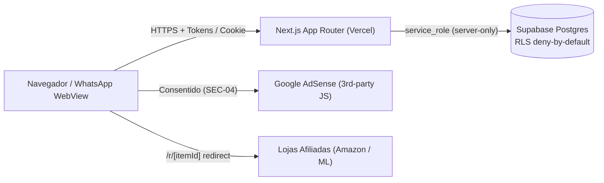

# Modelo de Ameaças (STRIDE) — Amigo Secreto

Cartão: **SEC-02** · Responsável: **Segurança & LGPD (15)** · Data: **2026-11-17**  
Referências: `RNF03`, `RNF04`, `RNF05`, `RN01–RN09`, `ADR-002`, `ADR-003`, `ARQUITETURA.md`.

## 1. Superfície de ataque e fronteiras de confiança

O Amigo Secreto é um monólito modular em **Next.js (Vercel)** sem login tradicional. A autenticação é feita por **capability URLs** (tokens no caminho da URL) e cookie de sessão `HttpOnly` opcional. O banco **Supabase Postgres** aceita conexões apenas do servidor (`service_role`).

**Fronteiras de confiança (Trust Boundaries):**
1. **Cliente (não confiável) → Borda Next.js:** entradas de formulário, parâmetros de rota (`inviteToken`, `accessToken`, `adminToken`), URLs de itens e cabeçalhos/IP.
2. **Next.js (servidor) → Supabase Postgres:** queries e RPCs transacionais com `service_role`; acesso direto via chaves públicas (`anon`/`authenticated`) é bloqueado por RLS + `REVOKE ALL`.
3. **Aplicação → Terceiros (Google AdSense e Lojas Afiliadas):** scripts externos não podem acessar tokens secretos na URL nem dados pessoais; redirecionamentos não podem virar open redirect.

---

## 2. Matriz de ameaças STRIDE

| ID | STRIDE | Ameaça e vetor | Impacto / Req. | Severidade | Mitigação obrigatória | Agente dono |
| --- | --- | --- | --- | --- | --- | --- |
| **AM-01** | **I** (Information Disclosure) | **Vazamento do resultado do sorteio** na resposta ao cliente, no painel do organizador, em pré-carregamento (`prefetch`) ou em logs. | Quebra de sigilo do amigo secreto (`RN03`, `RNF04`). | **Crítica** | Sorteio calculado apenas no servidor (`run-draw` / `run_draw`); `get-my-result` só consulta o par do titular no servidor após ação explícita ("Revelar") e nunca retorna pares de outros participantes nem ao painel `/admin`; respostas pessoais sem cache compartilhado (`no-store`); logs nunca registram pares. | Feature Sorteio (`SRT-03`, `SRT-04`) / QA (`QA-04`) |
| **AM-02** | **S** (Spoofing) | **Adivinhação ou força bruta de tokens** (`adminToken`, `accessToken`, `inviteToken`) ou ataque de temporização na comparação. | Acesso indevido ao painel admin ou ao resultado de outro participante (`RNF03`, `ADR-002`). | **Crítica** | Gerador criptográfico `crypto.randomBytes(32)` em `base64url` (256 bits ≥ 128 bits); armazenar `admin_token_hash` e `access_token_hash` apenas como SHA-256 hex; comparação em tempo constante (`timingSafeEqual`); rate limit por IP nas rotas sensíveis e `CHECK` de tamanho mínimo em `invite_token` no banco. | Segurança & LGPD (`SEC-01`, `SEC-03`) / Banco de Dados (`DB-01`) |
| **AM-03** | **I** (Information Disclosure) | **Vazamento de `accessToken` / `adminToken` via URL** por `Referer` HTTP, indexação em buscadores, histórico ou **scripts de terceiros (Google AdSense)** lendo `window.location.href`. | Terceiros ou buscadores capturam o link pessoal/admin e acessam o resultado (`RN03`, `RNF03`, `ADR-002`). | **Crítica** | `Referrer-Policy: no-referrer` e `X-Robots-Tag: noindex, nofollow` (e `<meta name="robots" content="noindex">`) em todas as rotas com token; **proibido carregar AdSense em URL com `accessToken`** — trocar o token da URL por cookie por grupo `ptk_<groupId>` (`HttpOnly; Secure; SameSite=Lax`, expiração `groups.expires_at`) com redirect antes de renderizar slots (`MON-02`, `ADR-004`). | Front-end (`GRP-04`) / Segurança & LGPD (`SEC-03`, `SEC-06`) / Feature Monetização (`MON-02`) |
| **AM-04** | **I** (Information Disclosure) | **Enumeração de grupos ou participantes** por respostas diferentes (404 vs 403, mensagem específica de "grupo não existe" vs "token inválido"). | Descoberta de grupos ativos e alvos para phishing/spam (`ADR-002`). | **Média** | Resposta e mensagem genéricas idênticas para token inexistente, tipo trocado ou grupo expirado/removido, sem revelar se o grupo existe; rate limit por IP. | Feature Grupos (`GRP-05`) / Feature Participantes (`PAR-02`) / Feature Sorteio (`SRT-01`) |
| **AM-05** | **T / I** (Tampering / Info Disclosure) | **Links maliciosos e Open Redirect** em itens da lista de desejos (`javascript:`, `data:`, `http:` ou redirecionamento arbitrário em `/r/[itemId]`). | Execução de script (XSS), phishing ou uso do domínio como vetor de open redirect. | **Alta** | Validar esquema `https:` estrito com Zod na borda e `CHECK` no banco (`wish_items`); em `/r/[itemId]`, redirecionar apenas por `itemId` válido no banco, validando esquema `https:` e permitindo apenas domínios autorizados de afiliado (allowlist Amazon / Mercado Livre) antes do redirect; usar `rel="noopener noreferrer"`. | Feature Lista de desejos (`LST-02`, `LST-03`) / Banco de Dados (`DB-01`) |
| **AM-06** | **T** (Tampering) | **XSS armazenado ou refletido** em nome do grupo, local, `display_name`, título ou observação da lista de desejos. | Roubo de sessão/cookie (se não `HttpOnly`), adulteração da tela ou redirecionamento malicioso. | **Alta** | React escapa texto por padrão (proibido `dangerouslySetInnerHTML` com entrada de usuário); sanitização e limites de tamanho com Zod na borda; CSP restritiva (`script-src` controlada, `object-src 'none'`, `base-uri 'self'`, `frame-ancestors 'none'`); cookie por grupo `ptk_<groupId>` com `HttpOnly; Secure; SameSite=Lax` e expiração = `groups.expires_at`. | Front-end / Back-end / Segurança & LGPD (`SEC-03`) |
| **AM-07** | **D** (Denial of Service) | **Abuso/spam na criação de grupos, entradas e sorteios** (bots criando milhares de grupos ou lotando grupos até o limite de 100 pessoas). | Indisponibilidade, exaustão de cota do Supabase/Vercel e degradação para usuários reais (`RN09`). | **Alta** | Rate limit por IP em criação de grupo, entrada (`join-group`) e sorteio (`SEC-03`); limite rígido de 100 participantes ativos garantido no banco por trigger transacional com `FOR UPDATE` (`DB-02`); limite de 20 itens por lista (`LST-02`). | Segurança & LGPD (`SEC-03`) / Banco de Dados (`DB-02`) |
| **AM-08** | **E** (Elevation of Privilege) | **Acesso direto ao Supabase** com chave `anon` exposta no bundle ou chamada indevida fora do servidor, ou **cruzamento entre grupos** em `pairs`. | Leitura/escrita não autorizada de pares, tokens ou dados de outros grupos (`RN02`, `RN03`). | **Crítica** | `ENABLE` e `FORCE ROW LEVEL SECURITY` em todas as tabelas sem nenhuma policy para `anon`/`authenticated` + `REVOKE ALL` (`DB-02`); cliente Supabase `service_role` restrito ao servidor e nunca exportado para client components; FKs compostas `(group_id, id)` em `pairs` impedindo pareamento entre grupos distintos. | Banco de Dados (`DB-01`, `DB-02`) / DevOps (`SETUP-04`) |
| **AM-09** | **T / R** (Tampering / Repudiation) | **Condição de corrida em sorteio ou entrada simultânea** (duplo clique em "Sortear", entrada concomitante ao sorteio ou 101º participante). | Criação de duas versões válidas de sorteio, violação de `RN04`/`RN09` ou pares inconsistentes (`RN02`, `RN04`). | **Alta** | RPC transacional `run_draw` com lock no grupo e validação de versão/estado (`SRT-02`); índice único parcial de 1 sorteio ativo por grupo (`draws_one_active_per_group_uidx`); trigger `enforce_max_participants` com `SELECT ... FOR UPDATE` no grupo (`DB-02`). | Banco de Dados (`DB-02`, `SRT-02`) / Feature Sorteio (`SRT-03`) |
| **AM-10** | **I** (Information Disclosure) | **Coleta excessiva, rastreamento sem consentimento ou retenção além do prazo (LGPD)** — cookies de anúncio antes do aceite, dados pessoais em `events`/logs, ou dados mantidos após 60 dias. | Descumprimento da LGPD e `RNF05` / `RN08`; bloqueio no AdSense. | **Alta** | Coletar apenas `display_name` e lista de desejos (`RNF05`); `events` somente com `id`, `group_id`, `type`, `created_at` no servidor (sem `participant_id`, IP ou nome); não carregar cookies/anúncios personalizados antes do consentimento explícito (`SEC-04`); cron diário de expurgo 60 dias após `exchange_date` (`OPS-02`); política de privacidade e termos publicados (`MON-01`). | Segurança & LGPD (`SEC-04`) / Feature Monetização (`MON-01`, `MON-03`) / DevOps (`OPS-02`) |
| **AM-11** | **E / I** (Elevation / Info Disclosure) | **Acesso indevido ao Painel do Dono (`RF14`) ou vazamento de segredos** (`SUPABASE_SERVICE_ROLE_KEY`, `OWNER_PANEL_SECRET`, credenciais de afiliado). | Exposição de métricas agregadas internas ou comprometimento total do banco (`RF14`). | **Crítica** | Segredos exclusivamente em variáveis de ambiente (`.env*` no `.gitignore`, checagem no CI); `OWNER_PANEL_SECRET` validado no servidor via header/cookie `HttpOnly` com comparação em tempo constante (nunca na query string), com rate limit e `noindex`/`no-store`; painel exibe apenas totais agregados sem nomes ou pares. | DevOps (`SETUP-04`, CI) / Feature Monetização (`MON-03`) / Segurança & LGPD (`SEC-05`) |
| **AM-12** | **I / E** (Info Disclosure / Elevation) | **Organizador encaminha por engano o link admin no grupo do WhatsApp** junto ou no lugar do convite. | Qualquer convidado assume controle do painel admin (edita grupo, remove pessoas, dispara sorteio — `RN06`, `ADR-002`). | **Alta** | Aviso explícito para não compartilhar o link admin na tela de sucesso da criação (`GRP-03`) e link admin visualmente distinto do link de convite (rótulo, cor e posicionamento separados). | Feature Grupos (`GRP-03`) / Front-end (`UX-01`) |
| **AM-13** | **T / S** (Tampering / Spoofing) | **CSRF (Cross-Site Request Forgery)** em Server Actions ou endpoints que aceitam cookie `ptk_<groupId>`. | Ação forçada por página externa usando a sessão do participante (ex.: alterar/apagar itens da lista). | **Média** | Checagem nativa de `Origin`/`Host` das Server Actions do Next.js (e verificação equivalente em Route Handlers baseados em cookie) combinada com `SameSite=Lax` no cookie `ptk_<groupId>`. | Back-end / Segurança & LGPD (`SEC-03`) |

---

## 3. Baseline de controles obrigatórios (referência para implementação)

- **Tokens (`SEC-01`):** `crypto.randomBytes(32)` → `base64url` (43 chars, 256 bits); `hashToken(raw)` em SHA-256 hex (64 chars); `verifyToken(raw, expectedHash)` com `crypto.timingSafeEqual`; redação em logs/erros.
- **Cabeçalhos HTTP (`SEC-03` / `GRP-04`):**
  - Global: `Strict-Transport-Security`, `X-Content-Type-Options: nosniff`, `X-Frame-Options: DENY`, `Content-Security-Policy` (`frame-ancestors 'none'`, origens do AdSense liberadas apenas quando `ADS_ENABLED=true` e consentido).
  - Rotas com token (`/g/*`, `/p/*`, `/admin/*`): `Referrer-Policy: no-referrer`, `X-Robots-Tag: noindex, nofollow`, `Cache-Control: no-store`.
- **Banco (`DB-01` / `DB-02`):** RLS ligada e forçada sem policies em todas as tabelas; `REVOKE ALL` de `anon`/`authenticated`; FKs compostas em `pairs` por `group_id`; `CHECK` de esquema `https://` em `wish_items` e de comprimento/formato base64url em `invite_token`.
- **LGPD (`MON-01` / `SEC-04` / `OPS-02`):** Aviso de cookies antes de anúncios personalizados do AdSense; opção de recusa e revogação a qualquer momento; expurgo automático em `exchange_date + 60 dias`.
- **Revisão final (`SEC-05`):** Nenhum achado **Crítico** ou **Alto** aberto antes do `REL-01` / `v1.0.0`.
