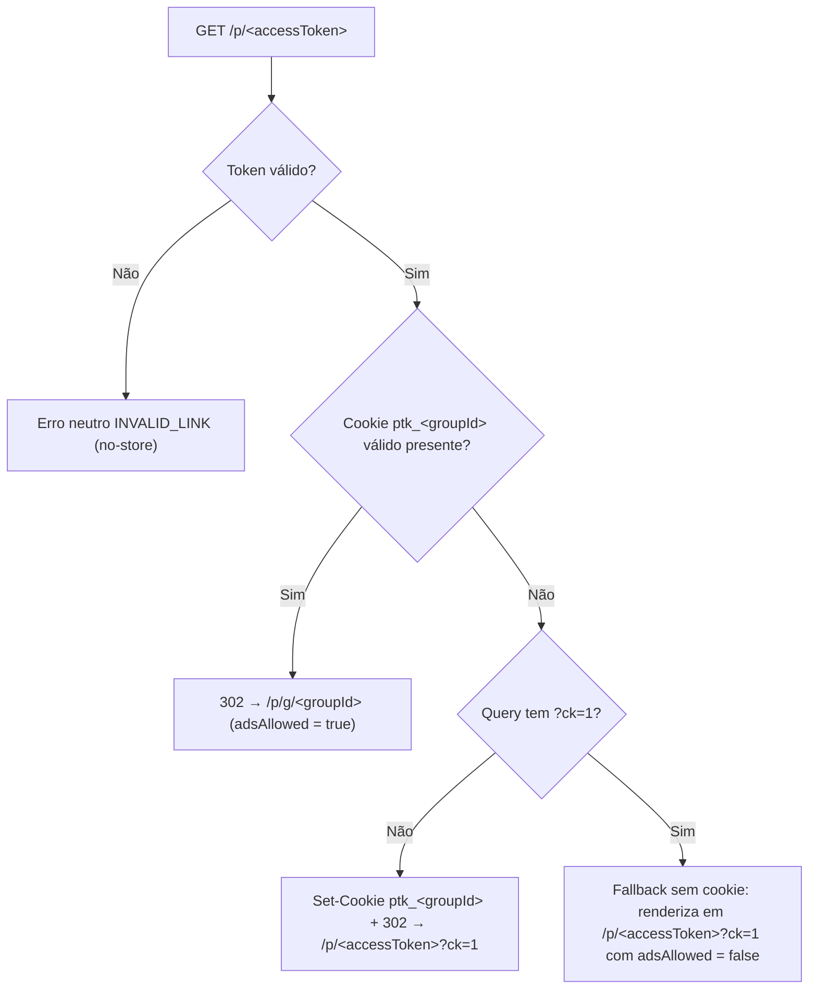

# ADR-004: Troca de token da URL por cookie por grupo antes de anúncios

- **Status:** proposta
- **Data:** 2026-11-17
- **Autor:** Segurança & LGPD (15)
- **Referências:** RN03, RNF03, RNF05, RNF08, ADR-002, `AMEACAS.md` (AM-03, AM-06, AM-13), `docs/features/participantes.md` §3, `docs/features/sorteio.md`, `docs/features/lista-desejos.md` §7.

## Contexto

O participante acessa sua área pessoal (lista de desejos `RF05` e revelação do sorteio `RF09`) inicialmente pela capability URL `/p/[accessToken]` (ADR-002). Conforme o modelo de ameaças (`AMEACAS.md` AM-03), os slots do Google AdSense (`MON-02`) não podem carregar enquanto o `accessToken` estiver presente na URL, pois scripts de terceiros leem `window.location.href` e vazariam o segredo pessoal (violando `RN03` e `RNF03`).

Por outro lado, o navegador interno (WebView) do WhatsApp e do Instagram (`RNF08`) pode bloquear ou descartar cookies. Portanto, o acesso do participante às suas funcionalidades essenciais não pode exigir suporte a cookies (`docs/features/participantes.md` §3).

## Decisão

Adotar uma troca automática do token na URL por um cookie `HttpOnly` específico por grupo (`ptk_<groupId>`) com redirecionamento para rota canônica sem token, combinada com detecção em passo único e **fallback sem cookie com anúncios desligados**.

### 1. Rota pós-redirect sem token

- **Rota canônica autenticada por cookie:** `/p/g/[groupId]`.
- `groupId` é apenas o UUID do grupo (não é segredo e não concede acesso sem o cookie `ptk_<groupId>` correspondente).

### 2. Fluxo de troca e detecção de cookie (sem loop)

1. **Validação inicial (`GET /p/[accessToken]`):** o servidor valida `accessToken` por hash SHA-256 em tempo constante (`SEC-01`). Token inválido, expirado ou de participante removido retorna erro neutro (`INVALID_LINK`), sem revelar existência do grupo.
2. **Cookie já presente (ex.: gravado no `join-group` ou em visita anterior):** redireciona (`302`) diretamente para `/p/g/[groupId]`.
3. **Probe de cookie (primeira visita sem cookie):** se a query ainda não possui `?ck=1`, o servidor grava o cookie:
   - Nome: `ptk_<groupId>`
   - Valor: `<accessToken>`
   - Atributos: `HttpOnly; Secure; SameSite=Lax; Path=/; Expires=<groups.expires_at>`
   - Redireciona (`302`) para `/p/[accessToken]?ck=1`.
4. **Segunda passagem (`GET /p/[accessToken]?ck=1`):**
   - **Cookie recebido:** confirma suporte a cookies e redireciona (`302`) para `/p/g/[groupId]` (URL limpa, sem token).
   - **Cookie ausente:** confirma que o navegador/WebView bloqueou cookies; não redireciona mais e renderiza a área do participante no **modo fallback sem cookie**.
5. **Cabeçalhos obrigatórios:** todas as respostas em `/p/[accessToken]*` e `/p/g/[groupId]` incluem `Referrer-Policy: no-referrer`, `X-Robots-Tag: noindex, nofollow` e `Cache-Control: private, no-store`.
6. **Acesso direto a `/p/g/[groupId]` sem cookie:** retorna estado neutro orientando o usuário a abrir seu link pessoal (`/p/<token>`), sem revelar dados do grupo.

### 3. Fallback quando o cookie não grava

- A página funciona integralmente usando o `accessToken` validado no servidor para exibir o grupo, gerenciar a lista de desejos (`RF05`) e revelar o sorteio (`RF09`).
- **`adsAllowed = false` obrigatório:** nenhum `<script>` do Google AdSense nem slot de anúncio é incluído no HTML. Isso elimina o risco AM-03 mesmo sem cookie.
- **Cliques de afiliado (`LST-03`):**
  - No modo com cookie (`/p/g/[groupId]`), `POST /api/affiliate-click` (`sendBeacon`) e o eventual `/r/[itemId]` usam o cookie `ptk_<groupId>` automaticamente, sem token em URL ou payload.
  - No fallback sem cookie (`/p/[accessToken]?ck=1`), `POST /api/affiliate-click` aceita `{ itemId, accessToken }` no corpo `POST` same-origin (nunca em query string, header de redirect externo ou logs). Caso o modo opcional `/r/[itemId]` venha a ser ligado para sessões sem cookie, deverá usar ticket efêmero assinado (HMAC-SHA256 vinculado a `itemId` e `groupId`), nunca `accessToken` na URL.

### 4. Impacto nos cartões

- **PAR-04 (Área do participante):**
  - Implementar o handshake `/p/[accessToken]` → `/p/g/[groupId]` com detecção `?ck=1` e `adsAllowed`.
  - Criar a rota `/p/g/[groupId]` lendo `ptk_<groupId>` (cookie `HttpOnly`), com verificação de origem/CSRF nativa das Server Actions (`AM-13`).
  - Permitir que a área do participante funcione no fallback sem cookie recebendo a credencial da rota no servidor (sem expor o token a scripts de terceiros).
- **MON-02 (Slots de AdSense):**
  - Condicionar a renderização dos slots e do script do AdSense a `ADS_ENABLED === true && consentGiven && adsAllowed === true`.
  - Nunca renderizar slots ou scripts de anúncio em `/p/[accessToken]`.

## Alternativas consideradas

- **Exigir cookie obrigatoriamente e bloquear WebViews sem cookie** — rejeitada porque viola `RNF08` e `docs/features/participantes.md` §3 (navegadores internos do WhatsApp/Instagram podem descartar cookies).
- **Remover o token no cliente com `history.replaceState` após o SSR** — rejeitada porque scripts de terceiros ou a própria janela inicial ainda acessam a URL com token antes/durante a hidratação, além de manter o token na navegação inicial.
- **Passar o token no fragmento da URL (`#token`)** — rejeitada porque fragmentos não são enviados ao servidor, inviabilizando o modelo server-first (`ARQUITETURA.md` §2) e a proteção por cookie `HttpOnly`.

## Consequências

- **Positivas:** elimina a exposição do `accessToken` para o Google AdSense (AM-03); mantém 100% da funcionalidade para usuários em WebViews sem cookie (`RNF08`); isola múltiplos grupos no mesmo aparelho via `ptk_<groupId>`; evita vazamento por `Referer` e barra de endereço em navegadores comuns.
- **Negativas / riscos:** sessões em WebViews que bloqueiam cookies não exibem anúncios do AdSense (trade-off aceito em favor do sigilo `RN03`/`RNF03`); adiciona um redirect na primeira visita quando o navegador não tiver gravado o cookie anteriormente no `join-group`.
