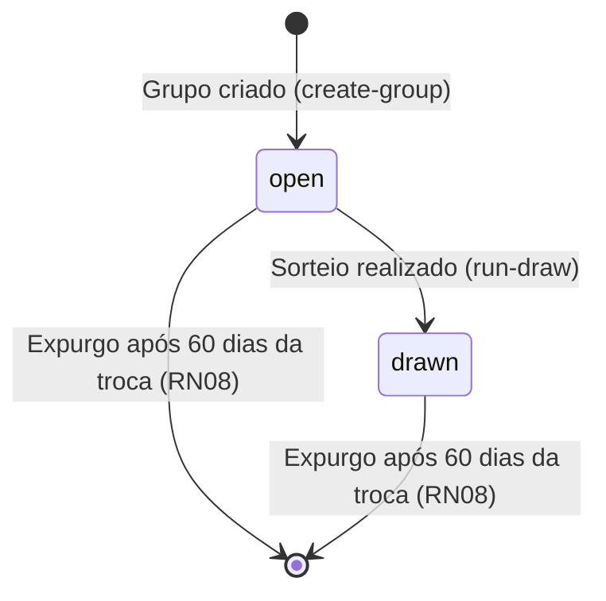

# Feature Grupos — Especificação

- **Dono:** Agente Feature Grupos (20)
- **Revisores:** Orquestrador (00), Segurança & LGPD (15), Front-end (11), Back-end (10)
- **Requisitos:** RF01, RF02, RF06, RF07, RN04, RN06, RN09, HU01, RNF01, RNF03, RNF05, RNF08, RNF09, RNF10, ADR-002
- **Itens do Backlog relacionados:** GRP-01 (Spec), GRP-02 (Caso de uso `create-group`), GRP-03 (Telas de criação e sucesso), GRP-04 (Open Graph e headers), GRP-05 (Painel admin e remoção)
- **Contrato canônico de back-end:** [`docs/arquitetura/CONTRATOS.md`](../arquitetura/CONTRATOS.md)

---

## 1. Visão Geral e Estados do Grupo

A feature de Grupos é a porta de entrada da aplicação. Permite ao organizador criar um grupo em menos de 2 minutos sem necessidade de cadastro, login ou senha (ADR-002). O organizador recebe dois links com tokens seguros (≥ 128 bits): o **Link de Convite** (público para compartilhar com os participantes) e o **Link de Administração** (privado para gerenciar o grupo e disparar o sorteio).

### Máquina de Estados do Grupo



| Estado | Significado | Ações Permitidas ao Organizador | Impacto nos Participantes |
| --- | --- | --- | --- |
| `open` | Grupo aberto para inscrições | Ver lista/contador, remover participantes (RF07), sortear se ≥ 3 participantes (RN01) | Podem entrar via link de convite (`/g/[inviteToken]`) e preencher lista de desejos |
| `drawn` | Sorteio concluído | Visualizar data do sorteio e lista final de participantes (sem ver os pares - RN03) | Convite fechado para novas entradas (RN04); participantes podem revelar seu amigo secreto |

---

## 2. Fluxo 1: Criação do Grupo (RF01, HU01, RNF01)

Rota: `/` (Landing Page + Formulário de Criação).  
Objetivo: Criação ágil e sem fricção no celular em **menos de 2 minutos** (RNF01).

### 2.1 Formulário e Entradas

O formulário é mobile first (largura de toque mínima de 48 px, tipografia ≥ 16 px):

1. **Nome do grupo** (`name`):
   - Texto obrigatório, 1 a 60 caracteres (`trim`).
   - Placeholder: *Ex.: Família Silva, Turma da Firma, Galera do Futebol*.
2. **Valor máximo sugerido** (`maxValueCents`):
   - Valor monetário obrigatório em Reais (R$), maior que zero (`maxValueCents > 0`).
   - Interface com máscara em R$ e conversão para número inteiro de centavos.
   - Placeholder: *Ex.: 50,00*.
3. **Data do encontro** (`exchangeDate`):
   - Data de calendário no formato `YYYY-MM-DD` (date picker nativo).
   - Validação: deve ser posterior a hoje considerando o fuso horário oficial `America/Sao_Paulo`.
4. **Local do encontro / Observações** (`location`):
   - Texto opcional, máximo de 120 caracteres. Normalizado para `null` se não preenchido.
   - Placeholder: *Ex.: Casa da Vó Maria às 20h / Churrascaria Boi Preto*.
5. **Botão de Ação**:
   - Rótulo: **"Criar Grupo de Amigo Secreto"** (com feedback de carregamento durante envio).

### 2.2 Processamento no Servidor e Idempotência (`create-group`, GRP-02)

1. **Validação na borda:** Server Action valida dados com Zod (regras tipadas de tamanho e formato).
2. **Identificador de Idempotência (`requestId`) (Decisão final ORQ + SEC):**
   - O cliente gera o `requestId` como UUID v4 na abertura do formulário e o armazena em `sessionStorage`. O servidor valida na borda que é um UUID v4 estrito (Zod).
   - **Mesmo `requestId` + mesmos dados em até 15 min:** numa transação com lock na linha do grupo (`groups.create_request_id`), se `status = 'open'` e o grupo ainda não tiver participantes, o servidor gera um novo token admin, substitui `admin_token_hash` no banco (invalidando o token anterior) e devolve o mesmo grupo com a nova `adminUrl`. Fora dessas condições (já tem participantes ou já sorteou), devolve o erro `IDEMPOTENCY_CONFLICT`.
   - **Mesmo `requestId` com dados diferentes, ou após 15 min:** o servidor devolve `IDEMPOTENCY_CONFLICT`. Nunca tenta um novo INSERT; a interface orienta a recarregar a página/formulário, o que gera um novo `requestId`.
   - **Após o sucesso:** o cliente remove o `requestId` do `sessionStorage`.
3. **Geração de Tokens (SEC-01, ADR-002):**
   - Utiliza exclusivamente o utilitário criptográfico oficial do agente de Segurança (SEC-01).
   - `invite_token`: 32 bytes base64url. Persistido em texto no banco em `groups.invite_token`.
   - `admin_token`: 32 bytes base64url. O servidor calcula o hash SHA-256 e grava em `groups.admin_token_hash`. O valor em claro é retornado apenas nesta resposta.
4. **Expurgo Automático (RN08):**
   - `expires_at = exchange_date + 60 dias` gravado em `groups.expires_at`.
5. **Persistência e Telemetria:**
   - Criação do registro em `groups` (`status = 'open'`, `draw_version = 0`).
   - Registro de evento anônimo em `events` (`type = 'group_created'`, sem dados pessoais, RNF05).
6. **Saída da Operação:**
   - Devolve URLs absolutas compostas no servidor: `{ inviteUrl: string, adminUrl: string }` (ver `CONTRATOS.md`).

---

## 3. Fluxo 2: Tela de Sucesso e Compartilhamento (RF02, HU01)

Após a criação bem-sucedida, o organizador vê a tela de confirmação:

```
┌────────────────────────────────────────────────────────┐
│               🎉 Grupo Criado com Sucesso!            │
│                 "Família Silva - Natal 2026"           │
├────────────────────────────────────────────────────────┤
│ 🔗 LINK DO CONVITE (Envie para a galera)               │
│ [ https://<dominio>/g/a8F9c... ]         [ Copiar ]    │
│                                                        │
│ [ 🟢 Compartilhar no WhatsApp ]                        │
├────────────────────────────────────────────────────────┤
│ 🙋 VOCÊ TAMBÉM VAI PARTICIPAR?                         │
│ Para participar do sorteio e receber um amigo secreto, │
│ você também precisa entrar pelo convite com seu nome.  │
│ [ Entrar no Grupo como Participante ]                  │
├────────────────────────────────────────────────────────┤
│ ⚠️ ATENÇÃO: SEU LINK DE ADMINISTRADOR                  │
│ Guarde este link com você. É por ele que você gerencia │
│ os participantes e realiza o sorteio. NÃO envie este   │
│ link no grupo!                                         │
│                                                        │
│ [ https://<dominio>/admin/xK92... ]      [ Copiar ]    │
│ [ Ir para o Painel do Administrador ]                  │
└────────────────────────────────────────────────────────┘
```

### 3.1 Compartilhamento no WhatsApp (RF02)

O botão **"Compartilhar no WhatsApp"** aciona `https://wa.me/?text=<mensagem_codificada>`:

**Template da Mensagem:**
```text
Oi pessoal! Criei nosso amigo secreto no Papelzinho: *{groupName}*! 🎁🎄

Data do encontro: {dataFormatada}
Valor sugerido: até R$ {valorFormatado}
Local do encontro: {localOuNaoInformado}

Toque no link abaixo para entrar só com seu nome e montar sua lista de desejos:
{inviteUrl}
```
*Codificado com `encodeURIComponent`.*

### 3.2 Organizador Também Participa (Alinhamento PAR-01 e SRT-01)

- O organizador **não é incluído automaticamente** como participante na criação do grupo.
- A tela de sucesso destaca a chamada:
  *"Você também vai participar? Entre pelo link de convite com seu nome"* acompanhada de um botão que leva à rota do convite (`inviteUrl`).
- Ao entrar pelo convite, o organizador é cadastrado na tabela `participants` e recebe seu cookie e link pessoal exatamente como qualquer outro participante (ADR-002).

### 3.3 Alerta de Sigilo do Link Admin

- Exibição com estilo de alerta de alta visibilidade visual.
- Mensagem: *"Este é o seu link secreto de organizador. Não compartilhe no grupo do WhatsApp, pois quem tiver este link pode alterar participantes e sortear os pares."*
- Botão "Copiar" e atalho para salvar no próprio WhatsApp (`wa.me`).

---

## 4. Fluxo 3: Painel do Organizador (RF06, RF07, RN06)

Rota: `/admin/[adminToken]`  
Casos de uso: `get-admin-view` e `remove-participant` (definidos em `CONTRATOS.md`).

### 4.1 Visualização do Painel (RF06)

1. **Acesso por Capability URL:**
   - O servidor computa o hash SHA-256 do token recebido e consulta o grupo.
   - Token inválido ou inexistente retorna o erro genérico: `"Este link é inválido ou não está mais disponível."` (sem revelar existência do grupo).
2. **Dados Exibidos (`AdminGroup`):**
   - Nome do grupo, Data do encontro (`exchangeDate`), Local do encontro e Valor máximo (`maxValueCents`).
   - Badge de estado: `Aberto para inscrições` ou `Sorteio Realizado em <data>`.
   - `inviteUrl` para cópia rápida do convite no painel.
   - Contador de participantes: `X participantes (máximo 100)` (RN09).
3. **Lista de Participantes Ativos:**
   - Lista os participantes com `removed_at IS NULL` (ID, nome de exibição e data de entrada).
   - Quando vazia: *"Nenhum participante entrou ainda. Compartilhe o link de convite acima!"*.
4. **Ação de Sortear (Integração SRT-01/SRT-03):**
   - Se `status == 'open'`:
     - `< 3 participantes`: Botão "Realizar Sorteio" desabilitado com aviso explicativo *"São necessários pelo menos 3 participantes para sortear."* (RN01).
     - `≥ 3 participantes`: Botão "Realizar Sorteio" habilitado.
   - Se `status == 'drawn'`: Vê a data em que o sorteio foi realizado. Os pares sorteados nunca são enviados para o painel (RN03).

### 4.2 Remoção de Participante (RF07, RN04, RN06)

1. **Permissão Restrita a Grupo Aberto:**
   - Botão "Remover" disponível ao lado de cada participante **apenas enquanto `status == 'open'`**.
   - Se o grupo estiver sorteado (`drawn`), a ação é bloqueada no cliente e rejeitada pelo caso de uso no servidor com `GROUP_CLOSED` (RN04).
2. **Confirmação:**
   - Diálogo de confirmação: *"Tem certeza que deseja remover [Nome]? Essa pessoa não participará do sorteio."*.
3. **Execução no Servidor (`remove-participant`):**
   - Atualiza `participants.removed_at = now()` (soft delete seguro).
   - O token pessoal do participante removido é revogado imediatamente.
   - O contador do painel decrementa e a lista é atualizada.

---

## 5. Mensagens e Validações Padronizadas

Mensagens rigorosamente alinhadas com as especificações de [Participantes](participantes.md) e [Sorteio](sorteio.md):

| Situação | Mensagem Apresentada na Interface |
| --- | --- |
| Link admin ou convite inválido, expirado ou grupo inexistente | `"Este link é inválido ou não está mais disponível."` |
| Nome do grupo fora de 1 a 60 caracteres | `"Informe um nome para o grupo entre 1 e 60 caracteres."` |
| Valor do presente menor ou igual a zero | `"O valor do presente deve ser maior que zero."` |
| Data do encontro no passado ou hoje no fuso `America/Sao_Paulo` | "Escolha uma data para o encontro a partir de amanh?." |
| Local do encontro com mais de 120 caracteres | "Use at? 120 letras no local do encontro." |
| Grupo atingiu o limite de 100 participantes (RN09) | `"Este grupo já está completo (100 pessoas)."` |
| Menos de 3 participantes para sortear (RN01) | `"São necessários pelo menos 3 participantes para sortear."` |
| Tentativa de remover participante em grupo já sorteado (RN04) | `"Não é possível remover participantes após a realização do sorteio."` |
| Conflito de dados no envio de mesmo `requestId` | `"Os dados enviados conflitam com uma criação anterior."` |

### Proteção de Privacidade (ADR-002, RNF03)
- Tokens inexistentes, malformados ou expirados geram **respostas idênticas** em código e mensagem, prevenindo ataques de enumeração.

---

## 6. Metadados, Open Graph e Headers de Segurança (RNF09, RNF03)

### 6.1 Prévia Open Graph para Convite (`/g/[inviteToken]`)

Metatags estáticas e dinâmicas geradas pelo Next.js App Router (o domínio `amigosecreto.app` abaixo é ilustrativo/exemplo até definição oficial):

```html
<meta property="og:type" content="website" />
<meta property="og:site_name" content="Papelzinho" />
<meta property="og:title" content="{group.name} — Papelzinho" />
<meta property="og:description" content="Você foi convidado para o amigo secreto '{group.name}'. Toque para entrar e montar sua lista de presentes!" />
<meta property="og:image" content="https://<dominio-exemplo>/images/og-invite-preview.png" />
<meta property="og:image:width" content="1200" />
<meta property="og:image:height" content="630" />
<meta property="og:url" content="https://<dominio-exemplo>/g/{inviteToken}" />
<meta name="twitter:card" content="summary_large_image" />
<meta name="twitter:title" content="{group.name} — Papelzinho" />
<meta name="twitter:description" content="Você foi convidado para o amigo secreto '{group.name}'." />
```

### 6.2 Headers de Segurança nas Páginas com Token

Aplicados no painel admin (`/admin/[adminToken]`):
- `<meta name="robots" content="noindex, nofollow, noarchive" />` e header `X-Robots-Tag: noindex, nofollow`
- `Referrer-Policy: no-referrer` (evita vazamento de token em links externos)
- `Cache-Control: private, no-store, max-age=0, must-revalidate`

---

## 7. Contratos da Camada de Aplicação

Os contratos canônicos de tipos, DTOs e ports estão centralizados e documentados em [`docs/arquitetura/CONTRATOS.md`](../arquitetura/CONTRATOS.md). A feature de Grupos consome:

- **Casos de uso correspondentes:**
  - `create-group`: recebe `Omit<GroupDetails, 'location'> & { location?: string | null; requestId: string }`, onde `exchangeDate` é string de calendário `YYYY-MM-DD`. Devolve `{ inviteUrl: string, adminUrl: string }`. Erro específico: `IDEMPOTENCY_CONFLICT`.
  - `get-admin-view`: recebe `{ adminToken: string }`, devolve `AdminGroup` (contém `group: GroupDetails`, `inviteUrl: string`, `draw: DrawState`, `participantCount: number`, `participants: { id, displayName, joinedAt }[]`). Erro: `INVALID_LINK`.
  - `remove-participant`: recebe `{ adminToken: string, participantId: ParticipantId }`, devolve `{ participantCount: number }`. Erros: `INVALID_LINK`, `GROUP_CLOSED`, `PARTICIPANT_NOT_FOUND`.
- **Port de Repositório (`GroupRepository`):**
  - Implementado pela infraestrutura Supabase (`createOnce`, `findByInvite`, `findAdminByHash`, `getAdminView`, `removeParticipant`).

---

## 8. Critérios de Aceite e Rastreabilidade

| Critério de Aceite | Requisitos Cobridos | Verificação |
| --- | --- | --- |
| Formulário valida nome (1–60), valor (> 0), data (futura em America/Sao_Paulo) e local (≤ 120) | RF01, RNF01 | Teste unitário de esquema Zod na borda |
| Criação concluída em menos de 2 minutos no celular | RNF01, HU01 | Teste exploratório mobile e E2E Playwright |
| Idempotência com `requestId` (15 min): reenvio devolve mesmo grupo com novo token admin; conflito de dados gera `IDEMPOTENCY_CONFLICT` | GRP-02, RNF03 | Teste de integração do caso `create-group` |
| Link de convite e botão WhatsApp com mensagem codificada formatada | RF02, RNF09 | Teste de integração do template e link de compartilhamento |
| Link admin gerado separadamente com alerta explícito de sigilo | RN06, ADR-002, HU01 | Inspeção visual e teste E2E |
| Chamada para organizador entrar como participante presente na tela de sucesso | HU01, PAR-01 | Teste de interface na tela de sucesso |
| Painel admin lista participantes ativos e contador atualizado | RF06, RN09 | Teste do caso `get-admin-view` |
| Remoção de participante permitida apenas com status `open` | RF07, RN04 | Teste do caso `remove-participant` |
| Link admin ou convite inválido exibe mensagem unificada com respostas idênticas | ADR-002, RNF03 | Teste de segurança HTTP e tela de erro |
| Metatags Open Graph no convite e `noindex`/`no-referrer` no painel admin | RNF09, RNF03 | Teste de metadados e headers HTTP |

---

## 9. Interfaces com Outras Features e Agentes

- **00 Orquestrador:** Aprovação da especificação GRP-01 e alinhamento do backlog.
- **10 Back-end:** Implementação dos casos de uso e contratos definidos em `CONTRATOS.md` (GRP-02).
- **11 Front-end:** Telas de criação, sucesso e painel admin com Design System UX-01 (GRP-03).
- **12 Banco de Dados:** Consumo das tabelas `groups`, `participants` e `events` (DB-01/DB-02).
- **13 QA / Testes:** Cenários de testes unitários, integração e E2E Playwright (QA-01/QA-03).
- **15 Segurança & LGPD:** Validação do mecanismo de idempotência de tokens e headers HTTP (SEC-01/SEC-03).
- **21 Feature Participantes:** Link de convite leva à tela `/g/[inviteToken]`, consumida por participantes e organizador.
- **23 Feature Sorteio:** O painel admin integra o gatilho "Realizar Sorteio" (`run-draw`).
